<div align="center">

# FERSA CARE

**Portal de pós-venda para peças FERSA: manuais, vídeos e fichas técnicas no celular,<br>com um assistente técnico de IA que cita as fontes e abre um chamado quando não resolve.**

[](https://github.com/LxzCunha/Fersa-Care/actions/workflows/ci.yml)
[](https://github.com/LxzCunha/Fersa-Care/actions/workflows/codeql.yml)


Projeto de **[Alexandre Breus da Cunha](https://github.com/LxzCunha)**

[Telas](#telas) · [Destaques técnicos](#destaques-técnicos) · [Arquitetura](#arquitetura) · [Como rodar](#como-rodar) · [Decisões de arquitetura](adr/)

</div>

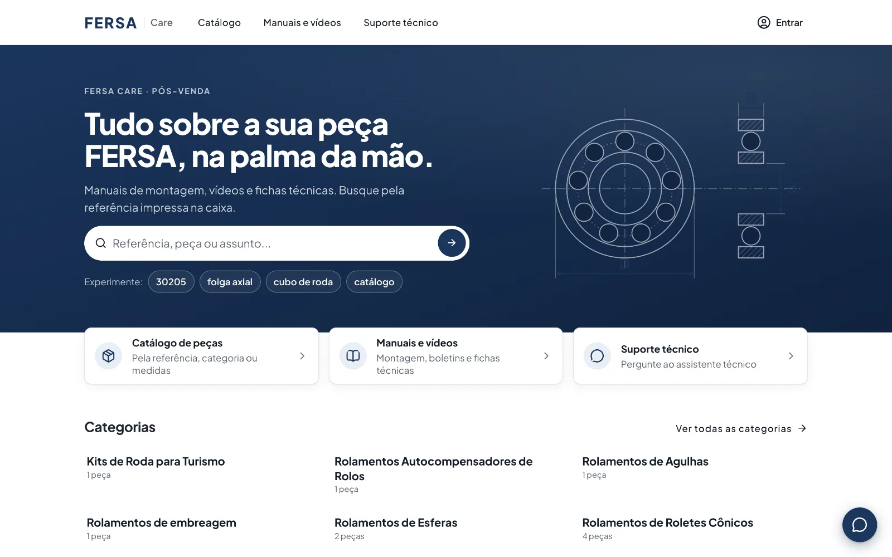

## Sobre o projeto

Quando um mecânico ou distribuidor tem dúvida sobre a montagem de um rolamento, a resposta costuma depender de um único técnico da fábrica. Os manuais existem, mas estão espalhados, e não há triagem: toda dúvida vira ligação ou mensagem.

O **FERSA CARE** reúne esse material num portal pensado primeiro para o celular. O cliente busca pela referência impressa na caixa da peça e encontra a ficha com as medidas, os manuais de montagem, os vídeos e os boletins. Se ainda tiver dúvida, pergunta ao **assistente técnico**, que responde com base nesses documentos e mostra de onde tirou a informação. Se o assistente não resolver, ele abre um **chamado** com a conversa inteira para a equipe técnica.

Por trás disso há três níveis de acesso (visitante, cliente aprovado e administrador), documentos liberados para pessoas específicas e uma área administrativa completa, com painel de uso e trilha de auditoria.

| Problema observado | Como o portal responde |
|---|---|
| Atendimento concentrado em um técnico | Autoatendimento com busca por código, aplicação e assunto, e um assistente que responde com base nos materiais oficiais |
| Falta de triagem | O assistente resolve as dúvidas comuns e só encaminha o que não conseguiu, já com o histórico da conversa |
| Informação espalhada | Biblioteca única com níveis de acesso, rascunhos, capas e o vínculo de cada material com as peças |

## Autoria

Projeto desenvolvido por **Alexandre Breus da Cunha** ([@LxzCunha](https://github.com/LxzCunha)) na Jornada de Aprendizagem do 4º período de Engenharia de Software (UniSENAI PR, Campus São José dos Pinhais).


---

## Telas

<table>
  <tr>
    <td width="50%">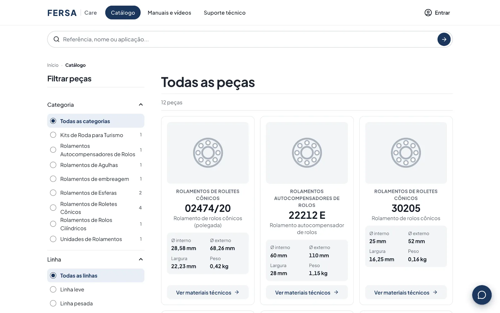<br><sub><b>Catálogo</b>: filtros por categoria, linha e medidas, com a ficha de cada peça.</sub></td>
    <td width="50%">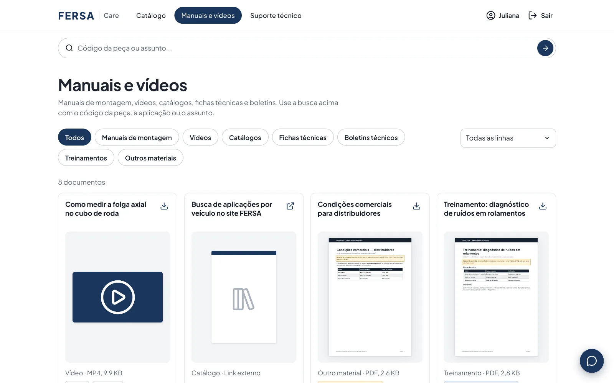<br><sub><b>Manuais e vídeos</b>: capas geradas automaticamente da primeira página do PDF.</sub></td>
  </tr>
  <tr>
    <td width="50%">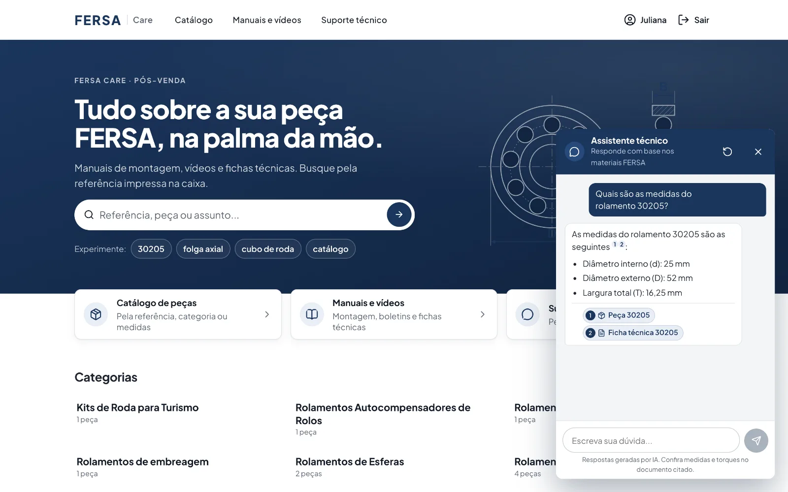<br><sub><b>Assistente técnico</b>: resposta em streaming com as fontes citadas.</sub></td>
    <td width="50%">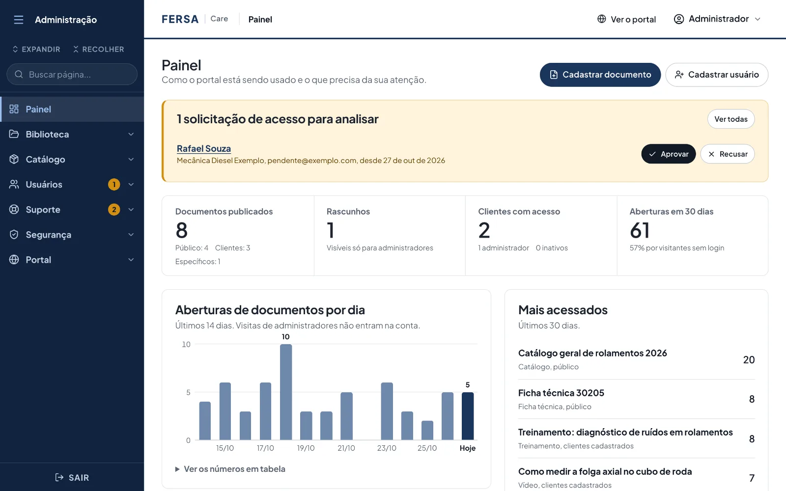<br><sub><b>Painel</b>: aprovações pendentes, aberturas por dia e documentos mais acessados.</sub></td>
  </tr>
  <tr>
    <td width="50%">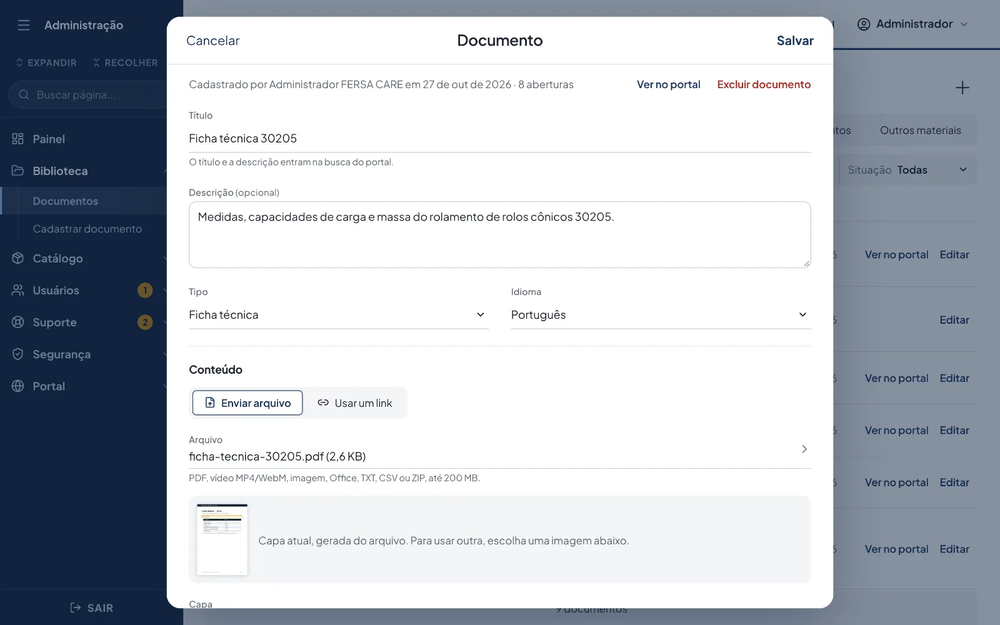<br><sub><b>Cadastro de documento</b>: arquivo ou link, capa, peças relacionadas e quem pode ver.</sub></td>
    <td width="50%">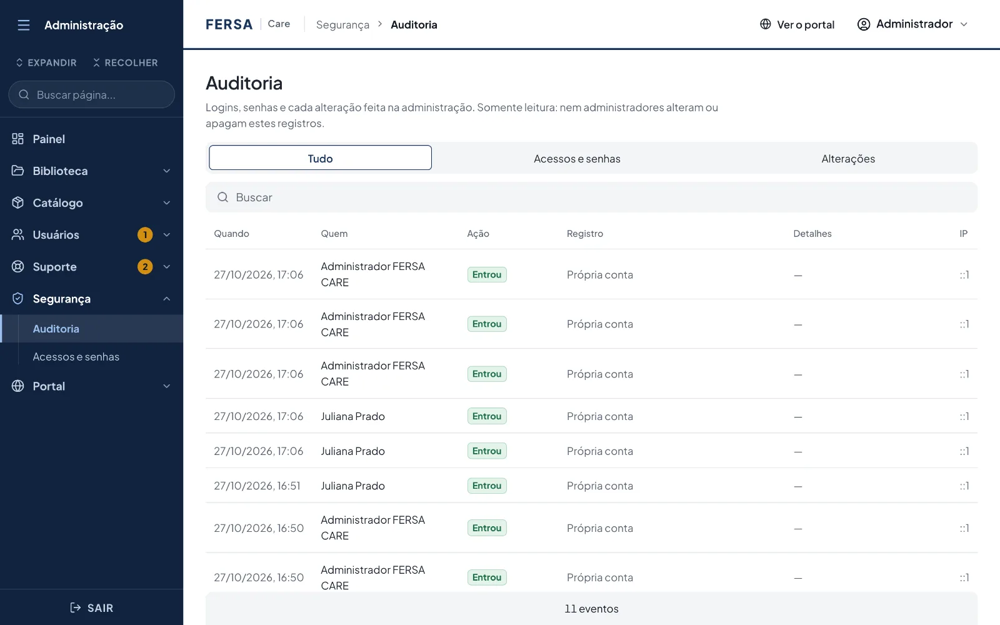<br><sub><b>Auditoria</b>: logins, senhas e cada alteração feita na administração.</sub></td>
  </tr>
</table>

**No celular**, com navegação inferior, filtros em gaveta e o assistente em tela cheia:

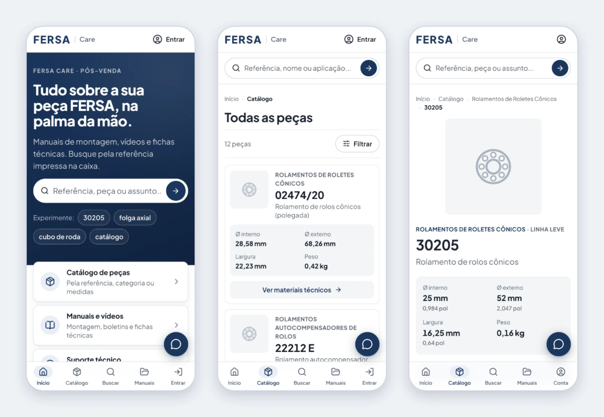

---

## Destaques técnicos

O que vale olhar no código:

1. **Assistente técnico com RAG que respeita permissões.** Os documentos são divididos em trechos, vetorizados (bge-m3) e guardados no próprio PostgreSQL com pgvector. A busca vetorial aplica a mesma regra de acesso do resto do portal, então o assistente nunca responde com base num documento que a pessoa não pode abrir. As respostas chegam por Server-Sent Events e citam as fontes. Insatisfação e pedido de atendimento são detectados de forma determinística e viram chamado. Os modelos rodam localmente no Ollama: nenhum dado sai do servidor.
   [`services/assistente.service.ts`](backend/src/services/assistente.service.ts) · [`repositories/trechos.repository.ts`](backend/src/repositories/trechos.repository.ts) · [`lib/assistente/`](backend/src/lib/assistente/)
2. **Uma única regra de visibilidade.** Lista, detalhe, download, capa, contagens e a busca do assistente usam a mesma função, que gera a condição SQL do que cada pessoa pode ver. Quem não tem acesso recebe 404, e a API nem confirma que o documento existe. Os testes cobrem a matriz completa de perfis × níveis de acesso.
   [`repositories/visibilidade.ts`](backend/src/repositories/visibilidade.ts) · [`tests/acesso-documentos.test.ts`](backend/tests/acesso-documentos.test.ts)
3. **Sessões que podem ser revogadas.** O JWT vai em cookie `httpOnly` e leva só o id e a versão da sessão, conferida no banco a cada requisição. Trocar a senha, desativar a conta ou "sair dos outros dispositivos" derruba todos os tokens na hora.
   [`lib/jwt.ts`](backend/src/lib/jwt.ts) · [`services/auth.service.ts`](backend/src/services/auth.service.ts)
4. **Trilha de auditoria somente inserção.** Cada login e cada alteração do admin é registrado com autor, campos alterados, IP e id da requisição, e um gatilho no banco recusa UPDATE e DELETE. Autor e IP vêm de um contexto aberto por requisição com `AsyncLocalStorage`, o mesmo que coloca o id da requisição em todas as linhas de log.
   [`services/auditoria.service.ts`](backend/src/services/auditoria.service.ts) · [`lib/contexto.ts`](backend/src/lib/contexto.ts) · [`drizzle/0009_auditoria_somente_insercao.sql`](backend/drizzle/0009_auditoria_somente_insercao.sql)
5. **Arquitetura em camadas, sem mágica.** `routes → controllers → services → repositories → models`, em módulos de funções. Os services não conhecem o ORM, as transações são explícitas e as entradas são validadas com Zod. As decisões estão documentadas em [`adr/`](adr/).
6. **569 testes automatizados.** São 323 na API, contra um PostgreSQL de verdade, com as migrações reais aplicadas a cada rodada. Outros 246 no site, com Testing Library usando a tela como uma pessoa usaria. Completam o pacote ESLint com informação de tipos, CI no GitHub Actions, CodeQL e Dependabot.
7. **Pensado para o celular e acessível.** Navegação inferior, filtros em gaveta e janelas nativas (`<dialog>`) com foco e Esc. O layout do admin reage ao espaço com container queries, e o lint de acessibilidade (jsx-a11y) roda no CI.

---

## Funcionalidades

### Níveis de acesso

| | Visitante | Cliente aprovado | Administrador |
|---|:---:|:---:|:---:|
| Documentos **públicos**, catálogo e busca | ✅ | ✅ | ✅ |
| Documentos para **clientes cadastrados** | pede login | ✅ | ✅ |
| Documentos para **pessoas específicas** | pede login | só se foi escolhido | ✅ |
| Rascunhos | — | — | ✅ |
| Assistente técnico e abertura de chamado | ✅ | ✅ | ✅ |
| Solicitar acesso | ✅ | — | — |
| Minha conta (dados, senha, sair dos outros dispositivos) | — | ✅ | ✅ |
| Cadastrar documentos, peças, categorias e usuários | — | — | ✅ |
| Aprovar acessos, atender chamados, painel e auditoria | — | — | ✅ |

- O cliente pede acesso e a conta nasce **aguardando aprovação**.
- Ao cadastrar um documento, o administrador escolhe quem vê: público, clientes cadastrados ou pessoas específicas, numa lista com busca.
- Visitante que abre o link de um material exclusivo é convidado a entrar e volta para o mesmo documento.

### Assistente técnico

- Responde **só sobre peças, produtos e dúvidas técnicas da FERSA**. Pergunta fora do assunto recebe um aviso educado.
- Usa os manuais, fichas e boletins que a pessoa pode ver, mais a ficha das peças citadas pelo código, e mostra as fontes numeradas.
- Na primeira reclamação, tenta de novo e oferece um chamado. Na segunda, ou se a pessoa pedir um atendente, abre o chamado: com a conta, se a pessoa estiver logada, ou pedindo nome e contato a quem é visitante.
- Sem o Ollama no ar, o portal continua funcionando e o assistente só oferece o chamado.

### Administração

Painel com aprovações pendentes e uso do portal; cadastros de documentos (upload com barra de progresso, capa automática ou enviada, peças relacionadas e lista de acesso), peças (foto e medidas), categorias e usuários; chamados com a conversa completa; e a trilha de auditoria. O menu lateral recolhe e vira gaveta no celular.

---

## Arquitetura

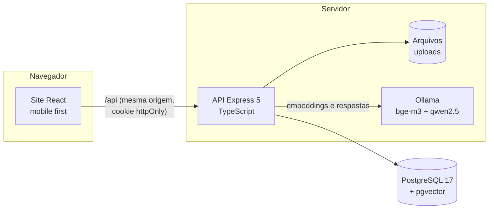

Em produção, uma única imagem Docker: a API entrega o site já compilado na mesma origem, sem CORS.

**Camadas da API:** `routes → controllers → services → repositories → models`. Cada camada só chama a de baixo; os services guardam as regras de negócio e nunca importam o ORM; só os repositories escrevem SQL.

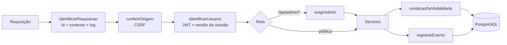

**Respostas de erro** seguem sempre o formato `{ erro: { codigo, mensagem, detalhes } }`. Os significados dos status: **401** pede login, **403** indica quem está logado mas não é admin, e **404** vale tanto para "não existe" quanto para "não está liberado para você".

<details>
<summary><b>Modelo de dados</b></summary>

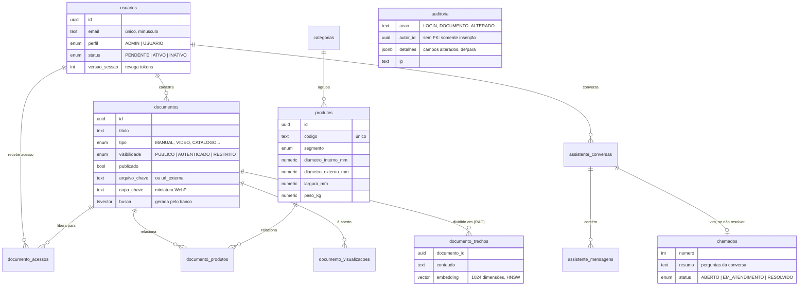

A busca usa o full-text search do PostgreSQL em português e ignora acentos (`manutencao` encontra "Manutenção"). Códigos de peça são comparados sem espaços e hífens (`32008X` encontra "32008 X").

</details>

<details>
<summary><b>Para quem vem do Java/Spring</b></summary>

| Spring (Java) | Neste projeto (Node + TypeScript) |
|---|---|
| `@RestController` | `routes/*.routes.ts` + `controllers/*.controller.ts` |
| `@Service` / `@Repository` | `services/*.service.ts` / `repositories/*.repository.ts` |
| `@Entity` / JPA | `models/*.model.ts` (Drizzle ORM) |
| `@Transactional` | `emTransacao()` em `db/index.ts` |
| Flyway / Liquibase | `drizzle/*.sql` + `npm run db:migrar` |
| Bean Validation | `validators/*.validator.ts` (Zod) |
| Spring Security | `middlewares/autenticacao.ts`, `origem.ts`, `limites.ts` |
| `SecurityContextHolder` / MDC | `lib/contexto.ts` (`AsyncLocalStorage`) |
| `@ControllerAdvice` | `middlewares/erros.ts` |
| JUnit + MockMvc | Vitest + Supertest |

</details>

### Stack

| Camada | Tecnologia |
|---|---|
| Site | React 19, TypeScript, Vite, React Router, TanStack Query, CSS com tokens próprios (identidade visual FERSA) |
| API | Node.js 24, Express 5, Zod, Drizzle ORM, pino |
| Banco | PostgreSQL 17 + pgvector (HNSW) + full-text search em português |
| IA | Ollama local: `bge-m3` (embeddings) e `qwen2.5:14b` (respostas), pdf.js para extrair texto |
| Testes | Vitest, Supertest, Testing Library, user-event |
| Qualidade e entrega | ESLint (typescript-eslint, react-hooks, jsx-a11y), GitHub Actions, CodeQL, Dependabot, Docker em várias etapas |
| Documentação | OpenAPI 3.1 + Swagger UI em `/api/docs`, [ADRs](adr/) |

---

## Como rodar

**Pré-requisitos:** Node.js 22.22+ (recomendado 24, ver `.nvmrc`) e Docker. O banco precisa da extensão **pgvector**; o `docker compose` já usa a imagem certa.

### Tudo num container

```bash
docker compose up --build     # http://localhost:3000
```

A imagem compila o site e a API, aplica as migrações, cria os dados de demonstração e serve tudo na porta 3000.

### Desenvolvimento

```bash
docker compose up -d db                 # PostgreSQL + pgvector (cria também o banco de testes)

cd backend
cp .env.example .env && npm install
npm run setup                           # migrações + dados de demonstração
npm run dev                             # API em http://localhost:3000 (Swagger em /api/docs)

cd ../frontend                          # em outro terminal
cp .env.example .env && npm install
npm run dev                             # site em http://localhost:5173
```

> Porta 5432 ocupada? Use `DB_PORTA=5433 docker compose up -d db` e ajuste `DATABASE_URL` e `DATABASE_URL_TESTE` no `backend/.env`.

### Assistente técnico (opcional)

```bash
ollama pull bge-m3 && ollama pull qwen2.5:14b
cd backend && npm run ia:indexar        # o assistente lê os documentos já cadastrados
```

Documentos novos ou editados são indexados sozinhos, em segundo plano.

### Logins de demonstração

| Perfil | E-mail | Senha |
|---|---|---|
| Administrador | admin@fersacare.com.br | Admin@123 |
| Cliente (oficina) | oficina@exemplo.com | Cliente@123 |
| Cliente (distribuidor, vê o documento restrito) | distribuidor@exemplo.com | Cliente@123 |
| Aguardando aprovação | pendente@exemplo.com | Cliente@123 |

Clientes, peças, documentos e números de acesso são **fictícios**.

---

## Testes e qualidade

```bash
# backend/   (precisa do banco no ar)
npm test                  # 323 testes: unidade + integração contra o PostgreSQL de teste
npm run test:unidade      # só os de unidade, sem banco (~1 s)
npm run lint && npm run typecheck

# frontend/  (API simulada)
npm test                  # 246 testes de telas e componentes
npm run lint && npm run build
```

- **API:** matriz completa de acesso (4 perfis × 4 níveis × lista, detalhe e download), CRUD campo a campo, uploads e capas, assistente com IA simulada (inclusive a matriz de acesso na busca vetorial), segurança (sessões revogadas, CSRF, JWT adulterado, arquivos disfarçados, limites de login, cabeçalhos) e auditoria.
- **Site:** cartões, filtros, busca, janelas de cadastro, chat do assistente, conta e auditoria, testados pela interface como uma pessoa usaria.
- **CI:** cada push e pull request roda lint, tipos, testes (com um PostgreSQL + pgvector de verdade), build, `npm audit` e a construção da imagem Docker.

---

## Segurança

| Ameaça | Controle |
|---|---|
| Força bruta | Limite de tentativas erradas por IP e por conta (também para e-mails inexistentes) |
| Vazamento do banco de senhas | bcrypt custo 12, com hashes antigos refeitos no login; limite de 72 bytes respeitado |
| Enumeração no login | Mesma mensagem e mesmo tempo de resposta para e-mail inexistente e senha errada |
| Roubo ou reuso de sessão | Cookie `httpOnly` + `SameSite=Lax` + `Secure`; versão da sessão revoga todos os tokens |
| JWT forjado | HS256 fixo (recusa `alg: none`), emissor, público e validade conferidos |
| CSRF | `SameSite` + conferência de `Origin`/`Sec-Fetch-Site` em toda alteração, inclusive no login |
| Acesso indevido a documentos (IDOR) | Regra única de visibilidade em toda consulta; 404 para o que a pessoa não pode ver |
| Arquivo malicioso disfarçado | Lista de extensões + conferência dos primeiros bytes (magic bytes); nome aleatório no servidor |
| XSS e clickjacking | CSP sem scripts inline, `frame-ancestors`, `nosniff`, `Permissions-Policy`, HSTS em HTTPS |
| Ações sem rastro | Trilha de auditoria que o banco não deixa alterar; logs JSON sem segredos, com id da requisição |
| Dependências vulneráveis | `npm audit` no CI, CodeQL e Dependabot |
| Vazamento de dados para IA externa | Modelos locais: perguntas e documentos não saem do servidor |

**Riscos conhecidos e assumidos:**

- "Solicitar acesso" informa quando o e-mail já tem cadastro (o formulário tem limite de 5 pedidos por hora por IP).
- Os limites de requisição ficam na memória de cada instância; com várias instâncias, o próximo passo é o Redis.
- Sair num aparelho apaga o cookie, mas um token copiado vale até expirar (8 h); trocar a senha derruba todos.
- Ainda não há segundo fator de login (MFA).

<details>
<summary><b>Principais rotas da API</b></summary>

A documentação interativa completa fica em `http://localhost:3000/api/docs`.

| Método e rota | Quem | Para quê |
|---|---|---|
| `POST /api/auth/entrar`, `POST /api/auth/sair` | todos | Login e logout |
| `POST /api/auth/solicitar-acesso` | visitante | Pedido de acesso (fica pendente) |
| `GET/PUT /api/auth/eu`, `PUT /api/auth/eu/senha` | logado | Minha conta (trocar a senha derruba as outras sessões) |
| `POST /api/auth/eu/encerrar-outras-sessoes` | logado | Sai da conta nos outros dispositivos |
| `GET /api/documentos`, `/resumo`, `/:id`, `/:id/arquivo`, `/:id/capa` | todos | Biblioteca, sempre filtrada pelo nível de acesso |
| `GET /api/produtos`, `/:id`, `/:id/imagem`, `GET /api/categorias` | todos | Catálogo (filtros por categoria, linha e medidas) |
| `POST /api/assistente/perguntas` | todos | Pergunta ao assistente (resposta em Server-Sent Events) |
| `GET /api/assistente/conversas/:id`, `POST /api/assistente/chamados` | quem começou a conversa | Retomar a conversa; abrir o chamado |
| `/api/admin/documentos`, `/usuarios`, `/produtos`, `/categorias` | admin | Cadastros |
| `/api/admin/chamados`, `GET /api/admin/painel` | admin | Chamados e painel |
| `GET /api/admin/auditoria` | admin | Trilha de auditoria (somente leitura) |
| `GET /api/saude`, `GET /api/saude/pronto` | todos | Liveness e readiness |

</details>

---

## Estrutura do repositório

```
├── backend/                 API REST (Node.js + Express + TypeScript)
│   ├── src/
│   │   ├── routes/          Caminho + método → middlewares → controller
│   │   ├── controllers/     Valida a entrada, chama o service, monta a resposta
│   │   ├── services/        Regras de negócio, transações, auditoria
│   │   ├── repositories/    Consultas SQL (Drizzle) e a regra de visibilidade
│   │   ├── models/          Tabelas e enums
│   │   ├── validators/      Esquemas Zod
│   │   ├── dtos/            Formato das respostas
│   │   ├── middlewares/     Contexto e logs, origem, autenticação, limites, upload, erros
│   │   └── lib/             JWT, senha, logs, arquivos, capas, assistente (RAG)
│   ├── drizzle/             Migrações SQL versionadas
│   ├── tests/               Unidade e integração
│   └── openapi.yaml         Contrato da API
├── frontend/                Site (React + TypeScript + Vite)
│   ├── src/                 api/, contexto/, componentes/, paginas/ (admin/ sob demanda), estilos/
│   └── tests/               Telas, componentes e funções
├── adr/                     Decisões de arquitetura
├── .github/                 CI, CodeQL, Dependabot e as imagens deste README
├── docker-compose.yml       PostgreSQL + pgvector, portal completo e Ollama (opcional)
└── Dockerfile               Imagem única: API + site, usuário sem privilégios
```

## Próximos passos

1. Conjunto de avaliação do assistente (30 a 50 perguntas reais com o documento esperado) antes de liberar aos clientes.
2. Recuperação de senha por e-mail e segundo fator (TOTP) para administradores.
3. Avisos por e-mail: nova solicitação de acesso e novo chamado.
4. Grupos de usuários (ex.: "Distribuidores") para liberar documentos a várias pessoas de uma vez.
5. Leitura de DOCX e OCR de PDFs escaneados para o assistente.
6. App em React Native reaproveitando a mesma API (o login por `Bearer` já funciona).

---

<details>
<summary><b>English summary</b></summary>

**FERSA CARE** is a mobile-first after-sales portal for FERSA bearings, built as an individual academic project by **Alexandre Breus da Cunha**. Customers find assembly manuals, videos and technical sheets by part number, and an **AI technical assistant (RAG)** answers questions citing the portal's own documents. The assistant runs locally with Ollama and pgvector, and opens a support ticket when it can't help.

Engineering highlights:

- A single access rule enforced in every document query, vector search included.
- Revocable JWT sessions (session version checked on every request).
- Layered CSRF defenses and magic-byte upload validation.
- An append-only audit trail backed by a database trigger.
- Structured logging with request ids.
- 569 automated tests, 323 of them against a real PostgreSQL.
- CI with GitHub Actions, CodeQL and Dependabot.

Stack: React 19, TypeScript, Express 5, Drizzle ORM, PostgreSQL 17 + pgvector, Ollama. Architecture decisions are documented in [`adr/`](adr/) (in Portuguese).

</details>

## Autor

**Alexandre Breus da Cunha** · [github.com/LxzCunha](https://github.com/LxzCunha)

© 2026 Alexandre Breus da Cunha. Todos os direitos reservados; veja [`LICENSE`](LICENSE). FERSA é marca de seus respectivos titulares e aparece aqui apenas para identificar o contexto do projeto.
