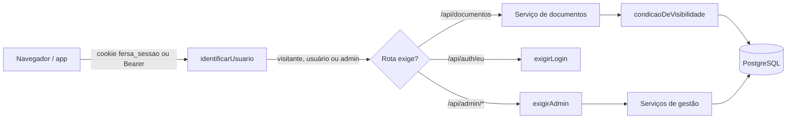
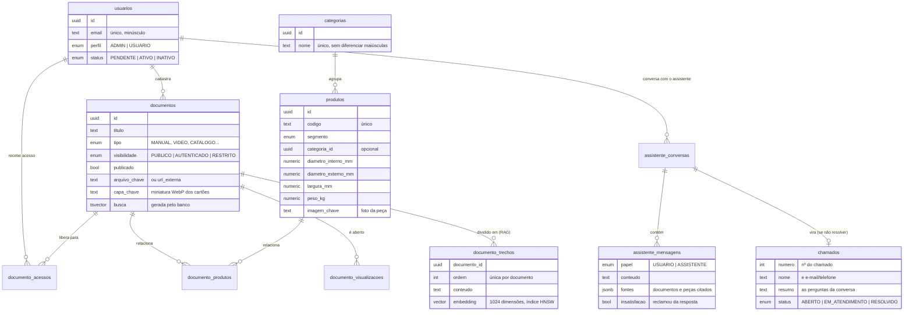

# FERSA CARE — portal de pós-venda

Portal web (mobile first) que reúne manuais de montagem, vídeos, catálogos, fichas técnicas e boletins das peças FERSA, com três níveis de acesso e caminho direto para o suporte técnico nos casos que os materiais não resolvem.

Projeto da Jornada de Aprendizagem do 4º período de Engenharia de Software (UniSENAI PR, Campus São José dos Pinhais).

| Camada | Tecnologia |
|---|---|
| Front-end | React 19 + TypeScript + Vite, React Router, TanStack Query — mobile first, com a identidade visual do site FERSA |
| API | Node.js + TypeScript + Express 5, validação com Zod |
| Banco | PostgreSQL + pgvector (base vetorial do RAG já criada) + Drizzle ORM |
| Autenticação | JWT em cookie httpOnly (e `Authorization: Bearer` para apps) |
| Testes | Vitest + Supertest contra um PostgreSQL de verdade |
| Documentação da API | OpenAPI 3.1 + Swagger UI em `/api/docs` |

---

## Os três níveis de acesso

| | Visitante (sem login) | Usuário logado (cliente) | Administrador |
|---|:---:|:---:|:---:|
| Documentos **públicos** | ✅ | ✅ | ✅ |
| Documentos para **clientes cadastrados** | pede login | ✅ | ✅ |
| Documentos para **usuários específicos** | pede login | só se foi escolhido | ✅ |
| Rascunhos | — | — | ✅ |
| Catálogo de peças (categorias, filtro por medidas) e busca | ✅ | ✅ | ✅ |
| Solicitar acesso | ✅ | — | — |
| Minha conta (dados e senha) | — | ✅ | ✅ |
| Cadastrar documentos e escolher quem vê | — | — | ✅ |
| Cadastrar categorias e peças (com foto e medidas) | — | — | ✅ |
| Aprovar solicitações e gerenciar usuários | — | — | ✅ |
| Painel com aberturas e mais acessados | — | — | ✅ |

Como funciona na prática:

- O cliente pede acesso em **Solicitar acesso**. A conta nasce **aguardando aprovação** e só entra depois que um administrador aprova (no painel ou em Usuários).
- Ao cadastrar um documento, o administrador escolhe **Público**, **Clientes cadastrados** ou **Usuários específicos** — neste último, seleciona as pessoas numa lista com busca.
- Desativar um usuário corta o acesso **na hora**, mesmo que ele esteja com o site aberto.
- Visitante que abre o link de um material exclusivo vê o convite para entrar e, depois do login, volta para o mesmo documento.

A regra de quem vê o quê fica **num único lugar**: [`backend/src/repositories/visibilidade.ts`](backend/src/repositories/visibilidade.ts). Lista, detalhe, download, contagens e a página de cada produto usam essa mesma função — e o assistente com RAG (fase 2) também vai usar, para nunca responder com base em um documento que a pessoa não pode ver.

---

## Como rodar em desenvolvimento

**Pré-requisitos:** Node.js 22.22 ou mais novo (recomendado: 24 LTS) e Docker (ou um PostgreSQL 16+ instalado **com a extensão pgvector**: as migrações a habilitam e falham num PostgreSQL comum).

> **Porta 5432 ocupada** por outro PostgreSQL na sua máquina? Suba o banco em outra porta com `DB_PORTA=5433 docker compose up -d db` e use essa porta em `DATABASE_URL` e `DATABASE_URL_TESTE` no `backend/.env`.

```bash
# 1. Banco de dados (na raiz do projeto)
docker compose up -d db

# 2. API — terminal 1
cd backend
cp .env.example .env
npm install
npm run setup        # cria as tabelas e os dados de exemplo
npm run dev          # http://localhost:3000  (Swagger em /api/docs)

# 3. Site — terminal 2
cd frontend
cp .env.example .env
npm install
npm run dev          # http://localhost:5173
```

Abra **http://localhost:5173**. O Vite repassa as chamadas `/api` para a API, então site e API funcionam como se fossem um só endereço.

### Assistente técnico (bolinha de chat)

O suporte técnico do portal é um assistente que responde **só sobre peças, produtos e dúvidas técnicas da FERSA**, com base nos manuais, fichas e boletins cadastrados, e cita as fontes. Se a pessoa reclama duas vezes que não ajudou (ou pede um atendente), ele abre um **chamado** para a equipe técnica, que aparece em Administração › Suporte › Chamados com a conversa inteira.

Os modelos de IA rodam na própria máquina, pelo [Ollama](https://ollama.com) (nenhuma pergunta ou documento sai do servidor):

```bash
ollama pull bge-m3        # embeddings (busca por similaridade)
ollama pull qwen2.5:14b   # respostas (troque em IA_MODELO_CHAT; um modelo menor responde mais rápido)
cd backend && npm run ia:indexar   # o assistente "lê" os documentos já cadastrados
```

Documentos novos ou editados são lidos automaticamente em segundo plano. Sem o Ollama no ar, o portal funciona normalmente e o assistente só oferece abrir um chamado.

### Logins de exemplo (criados pelo `npm run setup`)

| Perfil | E-mail | Senha |
|---|---|---|
| Administrador | admin@fersacare.com.br | Admin@123 |
| Cliente (oficina) | oficina@exemplo.com | Cliente@123 |
| Cliente (distribuidor, vê o documento restrito) | distribuidor@exemplo.com | Cliente@123 |
| Aguardando aprovação (não consegue entrar) | pendente@exemplo.com | Cliente@123 |

Produtos, documentos e visualizações de exemplo são **fictícios**, só para demonstrar o portal. Troque a senha do administrador em **Minha conta**.

### Rodar o portal completo com Docker

```bash
docker compose up --build     # http://localhost:3000
```

A imagem compila o site e a API, aplica as migrações, cria o administrador e os exemplos (`SEED_EXEMPLOS=true`), gera as capas de documentos que faltam e entrega tudo na porta 3000. Para produção, defina `JWT_SEGREDO`, `ADMIN_SENHA`, `SEED_EXEMPLOS=false` e `COOKIE_SEGURO=true` (com HTTPS).

---

## Comandos

| Onde | Comando | O que faz |
|---|---|---|
| backend | `npm run dev` | API com recarga automática |
| backend | `npm test` | Testes automatizados (200 testes: unidade + integração com o banco `fersa_care_teste`) |
| backend | `npm run test:unidade` | Só os testes de unidade (validações, DTOs, utilitários), sem banco |
| backend | `npm run typecheck` | Confere os tipos do TypeScript |
| backend | `npm run db:gerar` | Gera a migração SQL depois de alterar um model em `src/models/` |
| backend | `npm run db:migrar` | Aplica as migrações pendentes |
| backend | `npm run db:seed` | Cria o administrador inicial, se não existir |
| backend | `npm run db:seed:exemplos` | Também cria clientes, produtos e documentos fictícios |
| backend | `npm run ia:indexar` | Indexa os documentos para o assistente (pendentes; `-- --todos` refaz todos). Precisa do Ollama |
| backend | `npm run capas:gerar` | Gera as capas dos documentos que ainda não têm (ex.: cadastrados antes das capas existirem) |
| backend | `npm run db:studio` | Interface web para olhar os dados (Drizzle Studio) |
| backend | `npm run build` / `npm start` | Compila e roda em modo produção |
| frontend | `npm run dev` | Site em http://localhost:5173 |
| frontend | `npm run build` | Confere os tipos e gera o site em `frontend/dist` |
| frontend | `npm test` | Testes das telas (194 testes, com a API simulada; não precisa da API nem do banco) |

Os testes cobrem a matriz completa de acesso (visitante, usuário, usuário liberado e admin × documentos públicos, de clientes, restritos e rascunhos, na lista, no detalhe e no download), login e aprovação, upload e troca de arquivos, capas dos documentos, regras de administrador, busca e painel; o CRUD de peças, categorias, documentos e usuários campo a campo (validações, 404, duplicados); e, no site, os cartões, listas, filtros e janelas de cadastro. O banco de testes é criado pelo `docker compose` na primeira vez; com PostgreSQL próprio (com pgvector), crie um banco `fersa_care_teste` ou aponte `DATABASE_URL_TESTE` (no terminal ou no `backend/.env`).

---

## Estrutura do projeto

```
fersa-care/
├── backend/                     API REST (Node.js + Express + TypeScript), em camadas
│   ├── src/
│   │   ├── server.ts            Sobe o servidor (confere banco e pasta de uploads)
│   │   ├── app.ts               Monta o Express: segurança, rotas, Swagger, site
│   │   ├── config/env.ts        Variáveis do .env validadas na inicialização
│   │   ├── routes/              Caminho + método → middlewares → controller
│   │   ├── controllers/         Lê e valida a requisição, chama o service, responde
│   │   ├── services/            Regras de negócio (permissões, transações, arquivos)
│   │   ├── repositories/        Consultas ao banco (Drizzle) e a regra de visibilidade
│   │   ├── models/              Tabelas e enums do banco (uma tabela por arquivo)
│   │   ├── validators/          Esquemas Zod da entrada (corpo e filtros da URL)
│   │   ├── dtos/                Formato das respostas (ex.: nunca expõe o hash da senha)
│   │   ├── db/
│   │   │   ├── index.ts         Conexão com o banco e transações (emTransacao)
│   │   │   ├── migrar.ts        Aplica as migrações da pasta drizzle/
│   │   │   └── seed.ts          Administrador inicial e dados de exemplo
│   │   ├── middlewares/         Autenticação/perfis, limites de tentativas, upload e erros
│   │   └── lib/                 JWT, senha, armazenamento de arquivos, validação
│   ├── drizzle/                 Migrações SQL (versionadas no Git)
│   ├── seed/arquivos/           PDFs e vídeo de exemplo
│   ├── tests/                   Testes automatizados
│   └── openapi.yaml             Contrato da API (Swagger)
├── frontend/                    Site (React + TypeScript + Vite)
│   └── src/
│       ├── api/                 Chamadas à API e tipos das respostas
│       ├── contexto/            Usuário logado e notificações
│       ├── componentes/         Peças reutilizáveis (layout, busca, cartão de peça, listas...)
│       ├── paginas/             Telas do portal (início, busca, catálogo, categorias...)
│       │   └── admin/           Telas da administração (carregadas sob demanda)
│       ├── estilos/             Tokens de cor/tipografia e componentes visuais
│       ├── assets/marca/        Lugar do logotipo oficial da FERSA (ver LEIA-ME.md)
│       └── config.ts            Contatos do suporte e outras configurações
├── docker/postgres/             Script que cria o banco de testes
├── docker-compose.yml           PostgreSQL (+ portal completo)
└── Dockerfile                   Imagem única: API + site
```

### Camadas do back-end

Cada requisição desce pelas camadas **routes → controllers → services → repositories → models**, e cada camada só chama a de baixo:

- **routes** só ligam caminho e método aos middlewares e ao controller, sem nenhuma lógica.
- **controllers** validam a entrada com os `validators`, chamam o service e montam a resposta HTTP (status, cookie, cabeçalhos).
- **services** guardam as regras de negócio e não importam o Drizzle. Quando precisam de transação, usam `emTransacao` e repassam o `tx` aos repositories.
- **repositories** são os únicos que escrevem consultas. Toda leitura de documentos recebe o usuário da requisição e aplica `condicaoDeVisibilidade`.

### Para quem vem do Java/Spring

| Spring (Java) | Neste projeto (Node + TypeScript) |
|---|---|
| `@RestController` | `routes/*.routes.ts` (caminhos) + `controllers/*.controller.ts` (handlers) |
| `@Service` | `services/*.service.ts` |
| `@Repository` / Spring Data | `repositories/*.repository.ts` |
| `@Entity` / JPA | `models/*.model.ts` (Drizzle ORM) |
| `@Transactional` | `emTransacao()` em `db/index.ts` |
| Flyway / Liquibase | `drizzle/*.sql` + `npm run db:migrar` |
| DTO + Bean Validation (`@NotBlank`, `@Email`) | `dtos/*.dto.ts` (saída) + `validators/*.validator.ts` (Zod, entrada) |
| Spring Security (filtros, `@PreAuthorize`) | `middlewares/autenticacao.ts` (`identificarUsuario`, `exigirLogin`, `exigirAdmin`) |
| `@ControllerAdvice` | `middlewares/erros.ts` |
| `application.properties` | `.env` + `config/env.ts` |
| JUnit + MockMvc | Vitest + Supertest |
| Maven (`pom.xml`) | npm (`package.json`) |

---

## Como uma requisição é atendida



- **401** = precisa entrar (o site leva para o login). **403** = está logado, mas não é administrador. **404** = não existe ou não está liberado para esta conta — a API não revela que o documento existe.
- O token guarda só o id do usuário; perfil e situação são lidos do banco a cada requisição.

## Banco de dados



A busca usa o full-text search do PostgreSQL em português e ignora acentos (`manutencao` encontra "Manutenção"). Códigos de peça são comparados sem espaços e hífens (`32008X` encontra "32008 X").

## API

Com a API rodando, a documentação interativa fica em **http://localhost:3000/api/docs**. Principais rotas:

| Método e rota | Quem | Para quê |
|---|---|---|
| `POST /api/auth/entrar`, `POST /api/auth/sair` | todos | Login e logout |
| `POST /api/auth/solicitar-acesso` | visitante | Pedido de acesso (fica pendente) |
| `GET/PUT /api/auth/eu`, `PUT /api/auth/eu/senha` | logado | Minha conta |
| `GET /api/documentos`, `GET /api/documentos/resumo` | todos | Biblioteca filtrada pelo nível de acesso |
| `GET /api/documentos/:id`, `GET /api/documentos/:id/arquivo` | todos | Detalhe e conteúdo (com permissão) |
| `GET /api/documentos/:id/capa` | todos | Capa do documento (mesma permissão do documento) |
| `POST /api/assistente/perguntas` | todos | Pergunta ao assistente; a resposta chega aos pedaços (Server-Sent Events) |
| `GET /api/assistente/conversas/:id`, `POST /api/assistente/chamados` | quem começou a conversa | Retomar a conversa; abrir o chamado de suporte |
| `GET /api/produtos`, `GET /api/produtos/:id` | todos | Catálogo (filtros por categoria, linha e medidas) |
| `GET /api/produtos/:id/imagem` | todos | Foto da peça |
| `GET /api/categorias` | todos | Categorias com peças no catálogo |
| `GET /api/admin/painel` | admin | Números do painel |
| `/api/admin/documentos` (GET, POST, PUT, DELETE) | admin | Cadastro com upload, capa e lista de acesso |
| `/api/admin/usuarios` (+ `PATCH /:id/status`) | admin | Aprovação e gestão de usuários |
| `/api/admin/produtos` | admin | Gestão das peças (foto via multipart) |
| `/api/admin/categorias` (GET, POST, PUT, DELETE) | admin | Gestão das categorias |
| `/api/admin/chamados` (GET, PATCH) | admin | Chamados de suporte abertos pelo assistente |
| `POST /api/admin/documentos/:id/indexar` | admin | O assistente lê o documento de novo |

---

## Identidade visual

O front-end segue o site da FERSA (brasil.fersa.com): fundo branco, azul-marinho da marca, busca em pílula logo abaixo do cabeçalho, seção atual em pílula azul no menu, cartões de peça com a ficha de medidas em cinza e filtros em acordeão. No celular, os filtros abrem numa gaveta e a navegação principal fica na barra inferior.

- Cores, fonte (Plus Jakarta Sans) e raios ficam em [`frontend/src/estilos/tokens.css`](frontend/src/estilos/tokens.css). O resto do CSS só usa essas variáveis.
- **Logotipo:** coloque o arquivo oficial da FERSA em `frontend/src/assets/marca/fersa.svg` (ou `.png`/`.webp`). Ele é usado automaticamente no cabeçalho e no rodapé; sem o arquivo, aparece o nome em texto.
- A busca do cabeçalho filtra as peças no catálogo e os materiais em "Manuais e vídeos"; nas demais telas ela abre a busca geral, que procura nos dois.
- **Manuais e vídeos** aparecem em cartões com capa, título e botão de baixar. A capa sai sozinha da primeira página do PDF (ou da própria imagem); para vídeos, links e arquivos do Office, o administrador pode enviar uma capa no cadastro. Sem capa, o cartão mostra o ícone do tipo.

## Segurança

- Senhas com bcrypt; mensagem e tempo de resposta iguais para e-mail inexistente e senha errada.
- Sessão em cookie `httpOnly` + `SameSite=Lax` (protege contra roubo por XSS e contra CSRF); `secure` em produção.
- Limite de tentativas de login erradas e de solicitações de acesso por IP.
- Cabeçalhos de segurança com Helmet (CSP, nosniff, frame-ancestors).
- Uploads só dos formatos permitidos, com nome aleatório no servidor; o arquivo só é entregue depois de conferir a permissão, e nunca vai para cache compartilhado.
- O portal nunca fica sem administrador: ninguém tira o próprio acesso de admin.

## Como o código responde às causas do artigo

| Causa priorizada | O que o portal já faz | Próximo passo |
|---|---|---|
| 1. Atendimento concentrado em um técnico | Biblioteca de autoatendimento com busca por código, aplicação e assunto; página por peça | Assistente com RAG (fase 2) |
| 2. Falta de triagem | Navegação por tipo e por peça; contato com o suporte já leva o código da peça na mensagem | Triagem automática pelo assistente |
| 3. Informação espalhada | Portal central com níveis de acesso, rascunhos e lista de quem vê cada documento | Integração com o SharePoint |

O painel do administrador mostra aberturas por dia e os documentos mais acessados — dados para medir, na prática, quanto do atendimento passou a ser resolvido pelo portal.

## Próximos passos

1. **Assistente**: montar com a equipe técnica um conjunto de 30 a 50 perguntas reais (com a resposta e o documento esperados) e medir as respostas antes de liberar aos clientes; ler DOCX; avisar a equipe por e-mail quando abrir um chamado.
2. Avisar os administradores por e-mail quando chegar uma solicitação de acesso.
3. Grupos de usuários (ex.: "Distribuidores") para liberar documentos restritos a várias pessoas de uma vez.
4. Imagens dos produtos no catálogo e leitura de QR Code da embalagem.
5. Recuperação de senha por e-mail.
6. App nativo com React Native reaproveitando a mesma API (o login por `Bearer` já funciona).
7. Atendimento pelo WhatsApp Business API.
