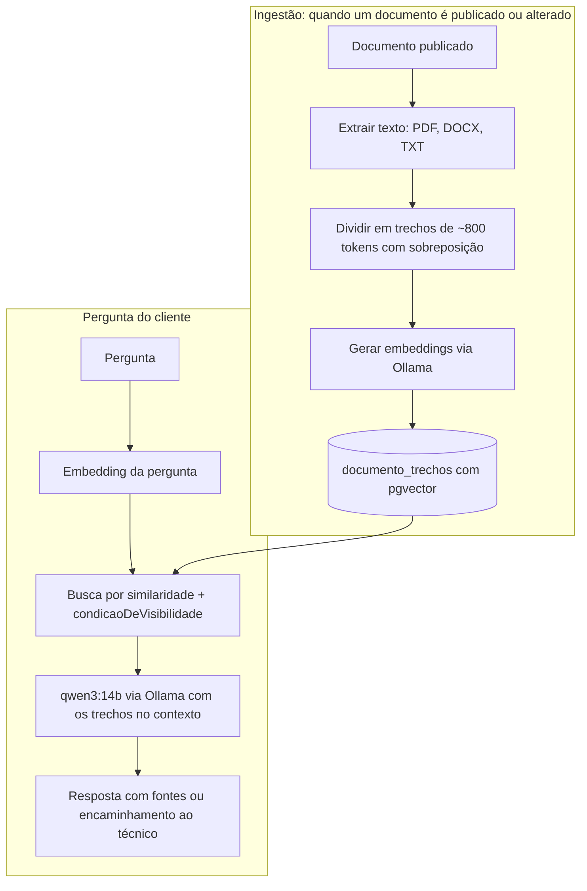

# Fase 2 — Assistente FERSA CARE com RAG

> Implementar **depois que o portal estiver estável** e com os documentos reais cadastrados. A qualidade das respostas depende diretamente da qualidade e da organização da base (seção 1.5.6 do artigo).

## Objetivo

Um assistente que responde dúvidas de montagem, aplicação e compatibilidade **usando apenas os documentos do portal**, cita as fontes e, quando não encontra resposta segura, encaminha o cliente ao técnico já com o contexto da conversa. Isso ataca diretamente as causas 1 (técnico sobrecarregado) e 2 (falta de triagem).

## Arquitetura



Tudo roda localmente: PostgreSQL com **pgvector** (a imagem do `docker-compose.yml` já tem a extensão) e **Ollama** servindo o modelo de linguagem `qwen3:14b` e um modelo de embeddings. O serviço `ollama` já está comentado no `docker-compose.yml`. Confira na documentação do Ollama a memória necessária para o `qwen3:14b` na máquina que vai rodar o assistente.

## 1. Banco de dados ✅

Já implementado:

- `backend/drizzle/0002_pgvector.sql`: migração escrita à mão que habilita a extensão (`CREATE EXTENSION IF NOT EXISTS vector`).
- `backend/drizzle/0003_documento_trechos.sql`: tabela `documento_trechos`, gerada a partir do model [`backend/src/models/documento-trecho.model.ts`](../backend/src/models/documento-trecho.model.ts).

| Coluna | Tipo | Observação |
|---|---|---|
| `documento_id` | uuid | Apagar o documento apaga os trechos (`ON DELETE CASCADE`) |
| `ordem` | integer | Posição do trecho no documento, única por documento |
| `conteudo` | text | Texto do trecho |
| `embedding` | `vector(1024)` | Índice HNSW com distância de cosseno (operador `<=>`) |

A dimensão 1024 é a do `bge-m3` (constante `DIMENSOES_DO_EMBEDDING`). O banco recusa vetores de outro tamanho, então trocar por um modelo de embeddings com outra dimensão exige uma migração nova e reindexar todos os trechos.

Sugestão de modelo de embeddings: um **multilíngue** (ex.: `bge-m3`), porque a FERSA tem materiais em português, espanhol e inglês.

## 2. Ingestão

Service novo `backend/src/services/ingestao.service.ts`, com as consultas em `backend/src/repositories/trechos.repository.ts`:

1. Chamado ao criar/editar um documento **publicado** com arquivo (no `services/documentos-admin.service.ts`, depois que a transação confirmar). Links externos e vídeos ficam de fora no início — para vídeos, dá para cadastrar a transcrição como texto.
2. Extrai o texto (`unpdf` para PDF, `mammoth` para DOCX).
3. Divide em trechos de ~800 tokens com ~100 de sobreposição, guardando o título do documento no começo de cada trecho.
4. Gera os embeddings chamando `POST http://ollama:11434/api/embed`.
5. Apaga os trechos antigos do documento e grava os novos, numa transação.

Para não travar o upload, rode a ingestão em segundo plano (uma fila simples com uma tabela `tarefas_ingestao` já resolve) e mostre no painel do admin a situação de cada documento: *indexado*, *na fila* ou *falhou*.

## 3. Busca respeitando o nível de acesso (ponto mais importante)

O assistente **nunca** pode usar um trecho de documento que a pessoa não poderia abrir. Por isso a busca, em `repositories/trechos.repository.ts`, reutiliza a mesma regra do portal:

```ts
import { and, asc, cosineDistance, eq } from 'drizzle-orm';
import { condicaoDeVisibilidade } from './visibilidade.js';

export async function buscarTrechos(perguntaEmbedding: number[], usuario: UsuarioAutenticado | undefined) {
  const distancia = cosineDistance(documentoTrechos.embedding, perguntaEmbedding);
  return db
    .select({
      conteudo: documentoTrechos.conteudo,
      documentoId: documentos.id,
      titulo: documentos.titulo,
      distancia,
    })
    .from(documentoTrechos)
    .innerJoin(documentos, eq(documentos.id, documentoTrechos.documentoId))
    .where(condicaoDeVisibilidade(usuario)) // ← a mesma regra da biblioteca
    .orderBy(asc(distancia))
    .limit(6);
}
```

Inclua na suíte de testes a mesma matriz de acesso já usada para os documentos: um visitante perguntando sobre o conteúdo de um documento restrito não pode receber esse trecho.

## 4. Geração da resposta

- Endpoint `POST /api/assistente/perguntas` com `{ pergunta, conversaId? }`, respondendo em streaming (Server-Sent Events) para o texto aparecer aos poucos no celular.
- Modelo: `qwen3:14b` via `POST http://ollama:11434/api/chat`.
- Instruções do sistema (resumo): responder em português, de forma objetiva; usar **somente** os trechos fornecidos; citar as fontes como `[1]`, `[2]` ligadas aos documentos; nunca inventar torque, folga, medida ou código; se os trechos não responderem, dizer isso e oferecer o técnico.
- Se a distância do melhor trecho passar de um limite (calibrado com perguntas reais), nem chame o modelo: responda direto com o encaminhamento.

## 5. Triagem e encaminhamento ao técnico

- Botão **Falar com o técnico** em toda resposta, abrindo o WhatsApp com a pergunta, o código da peça e os documentos consultados já na mensagem (o portal já monta mensagens assim no `BlocoSuporte`).
- Tabela `atendimentos` (pergunta, resposta, fontes, usuário, se foi encaminhado, avaliação 👍/👎) para medir quantas dúvidas o assistente resolveu e descobrir quais materiais estão faltando.

## 6. Avaliação (RAG Triad)

Monte com o técnico um conjunto de 30 a 50 perguntas reais com a resposta esperada e o documento que a contém. A cada mudança (modelo, tamanho do trecho, prompt), meça:

| Métrica | Pergunta que responde |
|---|---|
| Relevância do contexto | Os trechos recuperados têm a ver com a pergunta? |
| Fidelidade (groundedness) | A resposta se apoia só nos trechos, sem inventar? |
| Relevância da resposta | A resposta resolve a dúvida do cliente? |

Meta para liberar aos clientes: nenhuma resposta inventando especificação mecânica no conjunto de avaliação.

## Checklist de implementação

- [x] Migração com `CREATE EXTENSION vector` e tabela `documento_trechos`
- [ ] Serviço Ollama no `docker-compose.yml` e modelos baixados
- [ ] Extração e divisão de texto, com testes
- [ ] Fila de ingestão e situação de indexação no painel do admin
- [ ] Busca com `condicaoDeVisibilidade` + testes da matriz de acesso
- [ ] Endpoint com streaming e tela de conversa no front-end
- [ ] Encaminhamento ao técnico e registro de atendimentos
- [ ] Conjunto de avaliação e relatório das métricas
